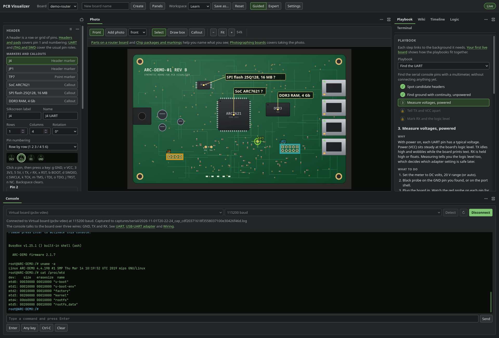
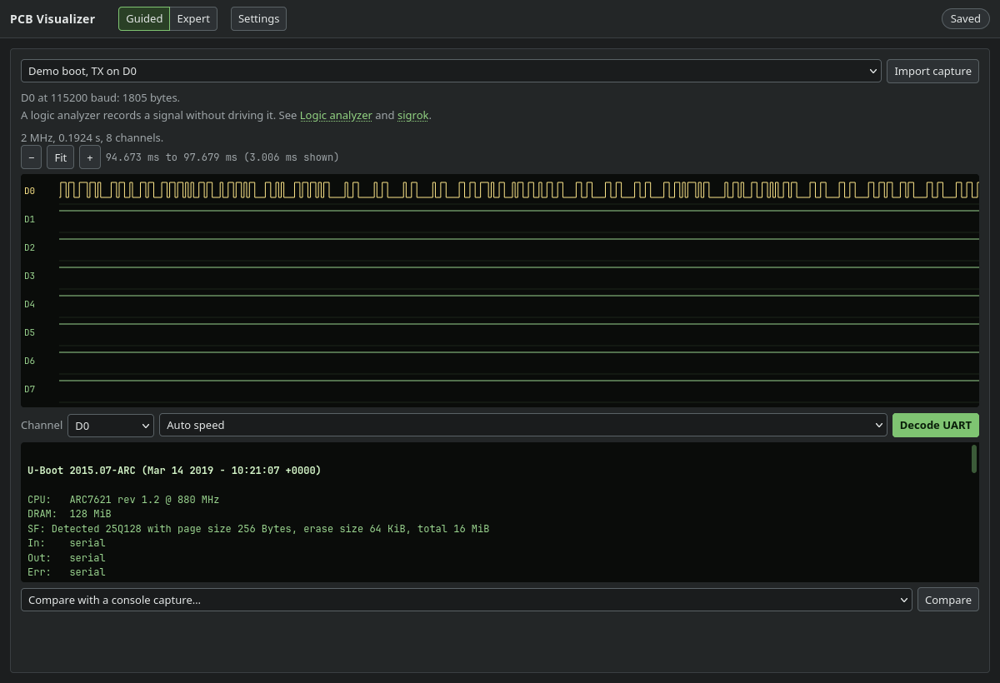
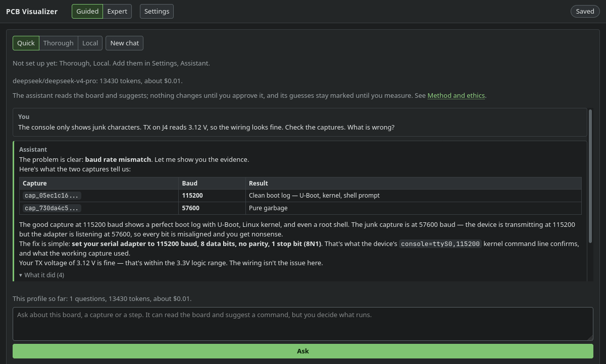
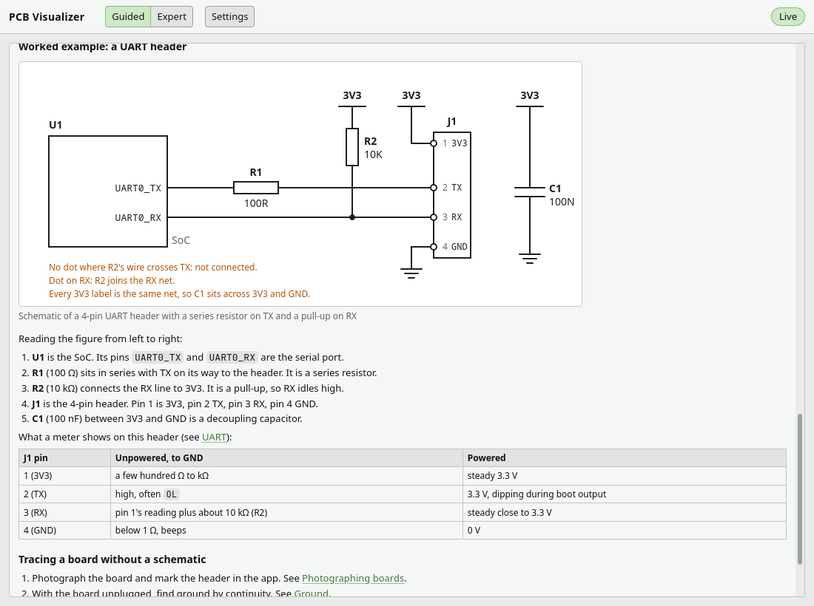

# PCB Visualizer

A local workbench to document and explore the debug interfaces of hardware you own. Photograph a board,
mark its headers and label the pins. Open a serial console, import logic captures and follow playbooks.
The app records every change in a plain folder that you can keep in git.



*The demo board with the console moved to the bottom. Header J4 is marked on the photo and its pins
are labelled 3V3, TX, RX and GND. The playbook is at step 3, measuring voltages. The Console is
connected to the virtual board (`pcbv vdev`) and has a root shell, which lists the flash partitions.*

| Feature | What it does |
|---|---|
| Board and pinout | Shows board photos with header markers and callouts. Each header has a pin grid. Each pin has a role, readings and notes. |
| Playbooks | Step-by-step procedures with safety gates and questions. They check your answers against what the board folder and the Console recorded. |
| Guided tutorial | *Find the UART* teaches the method on a practice board, kept apart from your own boards. It uses the real panels, with a coach beside them. |
| Guided or Expert | One switch in the top bar. Guided adds explanations, hints and links to the wiki. Expert removes them. Confirmations for destructive commands stay in both modes. |
| Console and shell | Serial sessions with speed detection and highlights for bootloader and login prompts. The app saves every session as a capture in the board folder. |
| Logic analysis | Reads sigrok session files and `sigrok-cli -O csv` output. Shows waveforms, decodes UART and compares the result with a console capture. |
| Timeline and wiki | One history of every event, capture and commit. 40 reference pages for beginners on electricity, schematics, tools, interfaces, boot and firmware. |
| Data in git | Optional, and off by default. A guided setup in Settings puts the data folder in a repository with a commit guard that scans for secrets. |
| Export | Annotated photos (PNG, SVG), a Markdown report, pinouts as CSV or JSON, and a zip of the board. Redacted by default. |
| Bench assistant | Optional, and off by default. Adds an Agent panel that suggests labels, pin roles and console commands. You approve each suggestion. |
| Desktop shell | A Tauri app with dockable panels, panels in their own windows, a Panels menu, saved workspaces and KWin rules for monitors. |

## Feature details

### Board and pinout

A single shortcut sets a pin role. See [Keyboard](#keyboard) for the list.

### Playbooks

The app has five playbooks: open and photograph, find the UART, get a console, bootloader recon, and
capture the UART with a logic analyzer.

### Guided tutorial

The tutorial goes from a photo of an unlabelled header to a shell on the virtual board. It ends with a
matching logic capture and an exported report.

### Console

The Console asks for a typed confirmation before common commands that write flash or bootloader settings.
The check uses a list of known commands, so it cannot catch everything. The Terminal panel has no such
check. A confirmation names the board, port and speed. It applies to that console session only.

### Logic analysis

The app reads sigrok session files (.sr) with up to 8 digital channels. The UART decoder expects 8 data
bits, no parity and 1 stop bit. To record a capture, use PulseView or `sigrok-cli`.

### Data in git

Boards are plain folders with or without git. To use git, turn it on in Settings. The guided setup has
five steps: tools, repository, ignored photo originals, an optional remote and a test sync.

The setup explains how to create a private GitHub repository and log in. When you set a github.com remote,
the app asks GitHub if the repository is public. It refuses a public repository, then checks that git can
read it. The same check runs before every push, so the app does not push to a repository that became public
later. `pcbv redact` makes a cleaned copy of a board for sharing.

### Bench assistant

The assistant is off by default. Until you turn it on in Settings, there is no Agent panel or Ask button,
and the app sends nothing anywhere.

The Agent panel works with any model server that speaks the OpenAI-compatible chat API. Many providers
support this common protocol, and you need no OpenAI account. OpenRouter, the DeepSeek API and a local
Ollama all use it.

The assistant reads the board through tools and can look at photos. It suggests labels, pin roles and
console commands. Each suggestion waits for your approval. Accepted labels and pin roles stay marked as
guesses until you check them. The assistant can add notes to the board's `analysis/findings.md` without
asking. It cannot run anything itself.

Settings shows how to set up each profile and has a **Test this profile** button. Each profile also sets
the effort per question. Normal allows up to 8 steps. Deep allows up to 24 steps and longer answers, at a
higher cost on a paid server.

## Network and data

The service listens on loopback only. Every API call needs the session token, except a health check and
the exchange of a one-time login code. The service sends the front end's own files without a token,
because they hold no board data. `pcbv open` starts the app with a code that works once and expires after
60 seconds. The token is never in a URL or on a command line.

Board data leaves your machine in two cases:

- `pcbv sync` pushes the data repository to its remote.
- An assistant profile with a cloud model sends that model the board data and logs involved in your
  questions.

Photos go only to a profile with "Send photos" selected. A profile for a server on another machine starts
with that switch off. The app deletes a stored key when the address of its profile changes. Model servers
on other machines must use https. A server on this machine may use plain http.


## Screenshots



*A logic capture of the same boot, decoded as UART at 115200 baud.*



*The Agent panel, here with `pcbv fake-model`, the simulated model server used for testing, so the
reply is canned. The assistant read the board and the boot log, then suggested a command. The command
is typed into the console only after you choose Send to console.*



*One of 40 reference pages, in the light theme.*

## Status

Version 0.1.0, with one maintainer. PCB Visualizer is built on Arch Linux with KDE Plasma (Wayland) and runs
on Linux. [ROADMAP.md](ROADMAP.md) lists the planned work.

The app and the service use protocol 2 together, so reload the app after an update. If the service stops
during a change, see [service recovery](docs/SERVICE.md#durability-and-recovery) and
[backup and recovery](docs/SCHEMA.md#backup-and-recovery).

## What you need

- **To try the app:** an Arch Linux machine (developed on KDE Plasma, Wayland) and the packages under
  Install. The tutorial's practice board, the demo board (`pcbv demo`) and the virtual board (`pcbv vdev`) need no hardware.
- **For a real board:** you need these items. Your user must be in the `uucp` group.
  - A multimeter for continuity, resistance and DC voltage.
  - A 3.3 V USB-UART adapter (CP2102, FT232R or CH340).
  - Female-to-female jumper wires.
  - A 2.54 mm pin header or test hooks.
  - Small screwdrivers and a plastic pry tool to open the case.
- **Optional:**
  - A logic analyzer, with sigrok and its FX2 firmware. The common 8-channel 24 MHz FX2 clones work.
  - A soldering kit, for header holes with no pins.
  - `gitleaks`, for git backup.

The app's Welcome and Settings check the software and show the command for anything missing. The
[What you need](service/src/pcbv/wiki/what-you-need.md) wiki page has the full list, with a page for each item.

## Install (Arch Linux)

### From the signed package repository

This is the quickest way, and new versions then arrive with your normal system updates. The package has
everything the app needs, including its own Python.

1. Get the signing key and tell pacman to trust it:

   ```sh
   curl -sO https://pcb.lethio.com/arch/lethio.asc
   sudo pacman-key --add lethio.asc
   sudo pacman-key --lsign-key 7ADF401F8B49E82ADB4B3DD0F8348B1E8C5C595B
   ```

   The last line is the key's fingerprint. It belongs to Terje Rutgersen (package signing)
   `<support@lethio.com>`.

2. Add the repository to the end of `/etc/pacman.conf`:

   ```ini
   [lethio]
   Server = https://pcb.lethio.com/arch/$arch
   ```

3. Install:

   ```sh
   sudo pacman -Syu pcbv
   ```

Start **PCB Visualizer** from the Plasma menu, or run `pcbv-desktop`. Updates come with `sudo pacman -Syu`.
pacman checks the signature of the package list and of each package, and refuses a file that was changed.
Remove the app with `sudo pacman -R pcbv`; your boards and settings stay.

### Download the package

To install one version without adding the repository, install the file from the GitHub release:

```sh
sudo pacman -U https://github.com/TerjeRu/pcb-visualizer/releases/download/v0.1.0/pcbv-0.1.0-1-x86_64.pkg.tar.zst
```

The release page gives the SHA-256 of the file. This way gets no automatic updates.

### From source

From a source checkout, `pcbv` is not on your PATH. Run each `pcbv` command as `uv run pcbv` in the
`service/` folder. An installed package puts `pcbv` on your PATH.

#### The app in a browser

```sh
sudo pacman -S --needed git uv nodejs npm
git clone https://github.com/TerjeRu/pcb-visualizer.git
cd pcb-visualizer
npm install
(cd service && uv sync)
```

`uv sync` downloads Python 3.12 for the service if your system has another version.

#### The desktop app

Also install Rust and the WebKitGTK libraries:

```sh
sudo pacman -S --needed rust webkit2gtk-4.1 base-devel curl wget file openssl appmenu-gtk-module libappindicator librsvg xdotool
```

Then run `npm run desktop` from the repository root. The first run compiles the shell, which takes a
few minutes. It needs `uv` on your PATH and starts the service itself when none is running.

To install it as a normal Arch package instead, with a menu entry in Plasma and `pcbv` on your PATH:

```sh
cd packaging/arch
makepkg -si
```

The build needs `git`, `uv`, `rust`, `nodejs` and `npm`, and the network. The package carries its own
Python for the service (about 100 MB). It builds from the git tag `v0.1.0`; to build a branch, use
`PCBV_REF=branch=<name> makepkg -si`. To update to the latest code, run `git pull` in the checkout, then
`PCBV_REF=branch=main makepkg -fsi` in `packaging/arch`; `-f` replaces the package file from the last
build. Remove it with `sudo pacman -R pcbv`; your boards and settings are not touched. `.deb` and
AppImage builds are not supported.

### First start

If you installed the package, start **PCB Visualizer** from the Plasma menu, or run `pcbv-desktop`.
The desktop app starts the service when none is running and stops it when you quit. To add a
ready-made demo board, run `pcbv demo` before you start the app.

From a source checkout, run these commands to use the app in a browser:

```sh
cd service
uv run pcbv demo                      # a ready-made demo board to explore
uv run pcbv serve                     # the service, on 127.0.0.1:8765
uv run pcbv open                      # in another terminal: the app in your browser
```

For the desktop app from source, run `npm run desktop` from the repository root instead.

On the first start with no boards, the app shows a Welcome page. The Welcome page offers three things:

- a guided tutorial, **Find the UART**, on a practice board that is kept apart from your own boards,
- a first board of your own,
- the Start here wiki page.

It also lists what the bench still needs, with the command for each: serial access, `sigrok-cli`, the
FX2 analyzer firmware and `gitleaks`. It links to the What you need page for the hardware and points to
the optional git and assistant setup. If you skip the Welcome page or open any board, it does not come
back. Settings can show it again, and can start, resume or restart the tutorial.

The tutorial has 18 steps in five chapters. The multimeter and the adapter wiring are simulated. The
Console, the Logic panel and the export are the real panels, working on the virtual board and a
practice capture.

The commands from here on use the installed `pcbv`. From a source checkout, run them as `uv run pcbv`
in `service/`.

`pcbv new "My Router"` creates a board of your own. Git is off until you turn it on in Settings
(top bar), which guides you through it. `pcbv repo init` does the repository step from the
command line, in `~/hw` by default. You need the repository for `pcbv sync`.

If you have no hardware, press **Start the virtual board** in the Console panel. It runs a virtual board
on a pseudo-terminal and lists it like a USB adapter. In a terminal, `pcbv vdev` does the same.
`pcbv fake-capture -o boot.sr` writes a logic capture of the board booting.

## Tools you may need

| Tool | What it is for | Install | Needed for |
|---|---|---|---|
| gitleaks | the commit guard that scans board data for secrets | `sudo pacman -S gitleaks` | committing board data (`pcbv sync`, or `git commit` in the data repo) |
| tio or picocom | a second serial terminal, to check the Console against | `yay -S tio` or `sudo pacman -S picocom` | optional |
| sigrok | making logic captures (the app reads them without it) | `sudo pacman -S sigrok-cli pulseview` | logic analyzers |
| FX2 firmware | the firmware sigrok loads into FX2-based analyzers (the common 8-channel clones); unplug and replug the analyzer after installing | `sudo pacman -S sigrok-firmware-fx2lafw` | FX2-based logic analyzers |
| the `uucp` group | access to USB serial adapters | `sudo usermod -aG uucp $USER`, then log out and in | real hardware |

## Command line

| Command | What it does |
|---|---|
| `pcbv new`, `pcbv status` | create a board, show boards and whether their files are consistent |
| `pcbv demo` | create the demo board shown above, with a drawn photo and made-up readings |
| `pcbv serve`, `pcbv open` | run the service, open the app |
| `pcbv note`, `pcbv measure` | add a note, record a multimeter reading on a pin |
| `pcbv shell` | a shell in the board folder with the whole session captured |
| `pcbv repo init`, `pcbv sync` | set up the data repo; commit through the guard, pull and push. A conflicting pull is rolled back (your commit is kept) and a rebase already in progress is left alone |
| `pcbv redact` | a copy of a board with credentials, serial numbers and addresses replaced, for sharing |
| `pcbv export` | annotated photos, a Markdown report, pinouts and a zip of a board, redacted by default |
| `pcbv agents-md` | write `AGENTS.md`, a briefing for coding agents, into a board folder (needs the assistant setting on) |
| `pcbv kwin-rules` | KWin rules that pin the desktop windows to monitors |
| `pcbv vdev`, `pcbv fake-capture`, `pcbv fake-model` | a virtual board, a practice capture, a simulated model server |

From a source checkout, run them as `uv run pcbv ...` in `service/`. `pcbv <command> --help` lists the
options.

## Board folders

Boards live in a separate git repo, `~/hw/boards` by default (`--root` or `PCBV_BOARDS_ROOT`
to change it):

```
my-router/
  journal/events.jsonl   append-only event log, the source of truth
  project.pcb.json       snapshot of the current state
  assets/                photos
  captures/              serial, shell and logic captures
```

The snapshot is plain JSON with stable formatting, so `git diff` shows real changes. If a script
or an editor changes it, the service records the change as an event the next time it opens the
board. Formats: `docs/SCHEMA.md`.

## Keyboard

With a pin selected in the Header panel, one shortcut sets its role:

| Key | Role | Key | Role | Key | Role |
|---|---|---|---|---|---|
| `G` | GND | `T` | TX | `K` | TCK |
| `V` | VCC | `R` | RX | `M` | TMS |
| `3` | 3V3 | `X` | RST | `I` | TDI |
| `5` | 5V | `B` | BOOT | `O` | TDO |
| `D` | SWDIO | `C` | SWCLK | `J` | TRST |
| `N` | NC | `Backspace`, `Del` | clear the role | | |

`Esc` steps back out (pin, then marker, then tool). `Backspace` or `Del` on a selected marker or
callout removes it. The keys work only while focus is in the Header panel or on the photo, never in a
text field or another panel. Clearing a pin that has a role and readings or a note asks first.

The rest of the window works from the keyboard too, with these limits:

- The Header panel lists every marker and callout on the board, with its name and kind. Choosing one
  from the list selects it on the photo and opens its form. Drawing a new box, placing a callout and
  dragging either one on the photo still need a pointer.
- **Add photo** and **Import capture** are buttons you can Tab to; Enter or Space opens the file chooser.
- `Ctrl+Shift+P` opens the Panels menu. The menu lists every panel with its place: docked, in its own
  window or put away. From the menu you can show, move or put away a panel. The arrow keys, `Home`, `End`
  and the first letters of a panel's name move through the menu. Firefox keeps this shortcut for private
  windows. The Panels button in the top bar works everywhere.
- In a region shown as tabs, the arrow keys, `Home` and `End` move between tabs.
- The panel menu (the three dots) takes the arrow keys, `Home` and `End`. `Esc` closes it and returns to
  its button. `Tab` closes it and moves on.

## Development

```sh
npm run test:all     # front end tests (node:test, jsdom) and service tests (pytest)
npm run lint         # front end lint; npm run lint:py for ruff
```

Start with `docs/ARCHITECTURE.md`. `docs/SERVICE.md` describes the service, its HTTP and WebSocket
protocol and the event list. `docs/DESKTOP.md` covers the panels and the desktop shell. `docs/PLAYBOOKS.md`
has the playbook format. `ROADMAP.md` lists the planned work. `tools/screenshots.mjs` takes the screenshots
above. The setup is at the top of the file.

## Safety

This is a tool for hardware you own. Probing a powered board can damage it and your USB adapter.

- Unplug the board before you find GND by continuity.
- Measure the pin voltages before you connect TX and RX.
- Leave the adapter's VCC unconnected.
- Do not probe a board with a mains power supply inside its case while it is powered. Such boards are out
  of scope.

The wiki's Bench safety page covers this in more detail.

## License and responsible use

MIT. Fork it and make it your own. Third-party software is listed in `THIRD_PARTY_LICENSES.md`.
`PRIVACY.md` tells what the app collects (nothing) and when data leaves your machine. Use this on
hardware you own, and read `RESPONSIBLE_USE.md` first. Security problems: see `SECURITY.md`.
