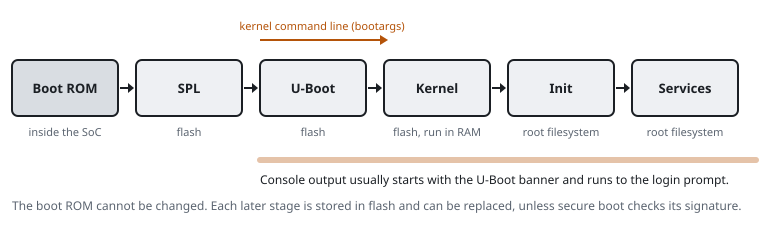

# The boot chain

An embedded Linux board starts in stages. Each stage sets up a little more hardware and then loads the next stage. When you know the stages, you know where you are in a boot log. You also know where a change takes effect.

## The stages

| Stage | Lives in | Does | In the boot log |
|---|---|---|---|
| Boot ROM | inside the SoC, unchangeable | finds and loads the first loader from flash, NAND, eMMC or the network | often nothing, or a few characters |
| First-stage loader (SPL, preloader) | flash | initialises RAM, which the boot ROM cannot | a short banner on some SoCs |
| Bootloader (U-Boot, CFE, Breed) | flash | sets up clocks, network and flash; loads the kernel; offers a prompt | the U-Boot banner, `DRAM:`, the autoboot countdown |
| Kernel | flash, loaded into RAM | starts drivers, mounts the root filesystem | `Linux version ...` and the timestamped lines after it |
| Device tree | flash, next to the kernel | describes the hardware of the board to the kernel | `Machine model:` |
| Init | the root filesystem | starts the system services (procd on OpenWrt, BusyBox init, systemd) | `init started`, `procd:` |
| Services | the root filesystem | network, Wi-Fi, web interface, TR-069 management | service messages, then `login:` or a shell prompt |

## How the kernel learns its settings

The bootloader passes a kernel command line to the kernel. The log shows it as `Kernel command line:`. It names the console (`console=ttyS0,115200`), the root filesystem (`root=/dev/mtdblock5`) and other options. In U-Boot it comes from the `bootargs` variable. See [U-Boot](u-boot).

## Where the console can be lost

- Some vendors build the kernel without a serial console, or with `console=` set to another port. The log then stops after `Starting kernel ...`.
- Init may not start a shell on the console, or it may ask for a password.
- The countdown of the bootloader may be zero, or the bootloader may wait for a particular input.

In each case you can still read the earlier stages. A log that stops partway tells you which stage stopped printing.

## Secure boot

On a board with secure boot, the boot ROM checks a signature on the next stage before it runs that stage. Each stage then checks the following stage. A modified bootloader or kernel does not start. The boot log often says so (`verify`, `signature`, `authentication`). You can still read the console, but modified firmware does not run.

Related: [Reading a boot log](reading-boot-logs), [U-Boot](u-boot), [Flash and filesystems](flash-and-filesystems).
