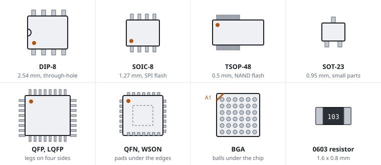

# Chip packages and markings

A package is the body a chip comes in: its size, its pins and the way the pins reach the board. The package decides if you can probe the chip or clip onto it. The marking tells you what the chip is.



## Packages

| Package | Pins | Pitch | Seen on routers as | Can you probe the pins? |
|---|---|---|---|---|
| DIP | two rows of legs through holes | 2.54 mm | rare on modern boards | yes, easily |
| SOIC, SOP | two rows of gull-wing legs | 1.27 mm | SPI flash (SOIC-8), small logic | yes; a SOIC clip fits |
| TSOP | two rows on the short sides, fine legs | 0.5 mm | parallel NAND flash (TSOP-48) | with care |
| TSSOP, MSOP | two rows, small body | 0.65 mm | small logic, EEPROM | with a fine probe |
| QFP, LQFP | legs on four sides | 0.4 mm to 0.8 mm | older SoCs, switch chips | with a fine probe; easy to short |
| QFN, DFN, WSON | pads under the edges, no legs | 0.4 mm to 0.65 mm | regulators, PHYs, WSON-8 flash | only at the pad edges |
| BGA | balls under the whole chip | 0.5 mm to 1 mm | SoCs, RAM, NAND | no; use test points or vias |
| SOT-23, SOT-223 | three to six legs | 0.95 mm | transistors, small regulators | yes |

## Pin 1 and numbering

A dot, a dimple, a notch at one end, or a bevelled edge marks pin 1. Seen from above, the pins are numbered anticlockwise from pin 1. On a BGA, the rows are letters and the columns are numbers. A1 is the corner with the marking.

## Reading a marking

A typical marking has three or four lines:

```
MXIC
MX25L12845EMI-10G
2Q154200
B114
```

- Manufacturer: a logo or a name (MXIC is Macronix).
- Part number: the line to search for. The suffixes give the package, the temperature range and the speed. The ordering information section of the datasheet explains them.
- Date code: often four digits for the year and the week (`1734` is 2017, week 34). Sometimes it is part of a longer lot code.
- Lot or batch code: the manufacturer uses it to trace the chip. It does not help you identify the chip.

Small chips (SOT-23, small QFN) carry a short code of two to four characters instead of a part number. Search for the code with the package name, for example "SOT-23 marking A7", or use an SMD marking code database. Then check the datasheet of the part you found.

## Passive parts

Resistors and capacitors have size names. The name gives the dimensions in hundredths of an inch:

| Size | Dimensions |
|---|---|
| 0402 | 1.0 x 0.5 mm |
| 0603 | 1.6 x 0.8 mm |
| 0805 | 2.0 x 1.25 mm |

Resistors of size 0603 and larger often carry a value code:

- `103` is 10 followed by three zeros, so 10 kΩ.
- `4R7` is 4.7 Ω.
- `000` or `0` is a zero-ohm link.

Capacitors usually have no marking. Measure them off the board or read the schematic.

## When the marking is unreadable

- Photograph the marking at an angle with light from the side. Laser-etched text shows up in reflections.
- Clean flux residue off the chip with isopropyl alcohol.
- Look up the board on the OpenWrt hardware pages or in the FCC filings. They often list the main chips.

Related: [Parts on a router board](board-parts), [Reading datasheets](datasheets), [SoC](soc).
