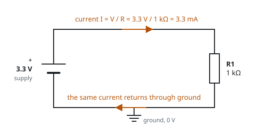

# Electricity basics

Four quantities describe almost everything you measure on a board: voltage, current, resistance and
power. This page defines them and shows how they relate.



## Voltage (V, volts)

Voltage is the difference in electrical potential between two points. You always measure it between
two points, so a multimeter has two probes. On a board, one of the two points is almost always
[ground](ground). "The pin is at 3.3 V" means "the pin is 3.3 V above ground".

Voltage pushes current through a circuit. A higher voltage across the same resistance drives more
current.

## Current (A, amperes)

Current is the rate at which charge flows through a conductor. Currents on a board are small. A UART
signal line carries well under 1 mA (milliampere, one thousandth of an ampere). A whole router draws
about 0.5 A to 1.5 A from its adapter.

Current flows only around a closed loop. A signal that leaves the adapter on TX must return through
GND, so the ground wire is required.

## Resistance (Ω, ohms)

Resistance is how strongly a component opposes current. A wire has almost none (below 1 Ω). A
resistor has a defined value, such as 10 kΩ (10 000 ohms). An open connection has so much resistance
that a meter shows `OL`.

## Ohm's law

The three quantities are linked by one equation:

```
V = I × R        I = V / R        R = V / I
```

Examples from a router board:

| Situation | Calculation | Result |
|---|---|---|
| 10 kΩ pull-up resistor from 3.3 V to a pin held low | I = 3.3 V / 10 000 Ω | 0.33 mA |
| 1 kΩ resistor in series with an LED, 1.3 V across the resistor | I = 1.3 V / 1000 Ω | 1.3 mA |
| A short circuit of 0.1 Ω across a 3.3 V rail | I = 3.3 V / 0.1 Ω | 33 A, limited only by the supply |

The last row shows the danger of a slipped probe. A resistance near zero asks the supply for much more
current than the board can deliver.

## Power (W, watts)

Power is the rate at which a circuit uses energy. In a resistor, the energy becomes heat:

```
P = V × I        P = I² × R        P = V² / R
```

A router that draws 1 A from a 12 V adapter uses 12 W. A small surface-mount resistor is rated for
about 0.1 W. If it gets more power, it overheats.

## Series and parallel

- **Series**: components one after the other, so the same current flows through each. The resistances
  add: 1 kΩ + 1 kΩ = 2 kΩ.
- **Parallel**: components side by side across the same two points, so each sees the same voltage.
  The combined resistance is lower than the smallest one. Two 1 kΩ resistors in parallel make 500 Ω.

You connect a voltmeter in parallel with the part you measure. It has a very high resistance, so it
barely disturbs the circuit. You connect an ammeter in series. It has a very low resistance, so a meter
lead left in the current socket shorts whatever it touches. See [Multimeter basics](multimeter).

## Voltage divider

Two resistors in series between a voltage and ground make an intermediate voltage at their joint:

```
Vout = Vin × R2 / (R1 + R2)
```

With 3.3 V, R1 = 10 kΩ and R2 = 20 kΩ, the joint is at 2.2 V. Dividers set reference voltages for
regulators. Some boards also use them as crude level shifters on UART lines.

## DC and AC

Boards run on direct current (DC): the voltage keeps the same polarity. Mains is alternating current
(AC). It is 230 V in Europe and 120 V in North America. The external power adapter of the router
converts it to low-voltage DC. Mains stays outside the case. See [Bench safety](safety).

## Supply rails

A rail is a supply voltage that the board distributes to its parts. A typical router has several:

| Rail | Typical use |
|---|---|
| 12 V (input) | from the power adapter; feeds the regulators |
| 5 V | USB ports |
| 3.3 V | I/O pins, flash memory, Ethernet chips, the UART |
| 1.8 V | DDR2 memory, I/O on newer SoCs |
| 1.0 V to 1.2 V | the SoC core |

Regulators make each rail from the one above it. Look for the parts with an inductor (a coil) and large
capacitors next to them. If a header pin measures a steady 3.3 V, it is connected to the 3.3 V rail.
This is how you find VCC on a [UART](uart) header.

## Capacitors and inductors

- A **capacitor** stores a small amount of charge. Small ones (100 nF) sit next to every chip and
  smooth its supply. These are decoupling capacitors. Large ones (100 µF and up) hold up a rail. A large
  capacitor can stay charged for a short time after you unplug the board.
- An **inductor** resists changes in current. Switching regulators and filters use inductors.

Related: [Ground](ground), [Logic levels](logic-levels), [Schematic symbols](schematic-symbols).
