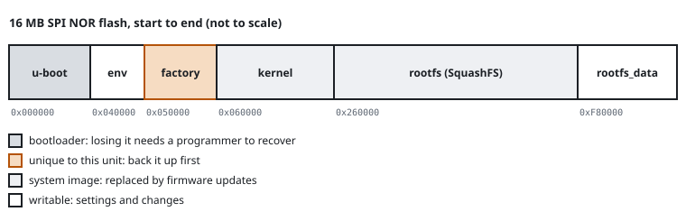

# Flash and filesystems

A router keeps everything it needs on one flash chip: the bootloader, the settings, the kernel and the root filesystem. Each has its own region. This page covers the flash types, the way the flash is divided and the filesystems in it.

## Flash types

| Type | Typical size | Package | Notes |
|---|---|---|---|
| SPI NOR | 4 MB to 32 MB | SOIC-8, WSON-8 | read byte by byte, very reliable; most routers |
| SPI NAND | 128 MB to 512 MB | WSON-8, BGA | larger, cheaper; has bad blocks and needs error correction |
| Parallel NAND | 128 MB to 1 GB | TSOP-48, BGA | as SPI NAND, with a wide bus |
| eMMC | 4 GB and up | BGA | NAND with its own controller; appears as a disk (`/dev/mmcblk0`) |

NAND flash wears out, and it comes from the factory with some bad blocks. Every page has extra spare bytes (the out-of-band area) for error correction codes. For this reason, two reads of a raw NAND dump differ more often than two reads of a NOR dump. Before you can unpack the dump, you must handle the spare area correctly.

## Partitions

The flash has fixed regions. Linux calls them MTD partitions and lists them at boot:

```
Creating 6 MTD partitions on "spi0.0":
0x000000000000-0x000000040000 : "u-boot"
0x000000040000-0x000000050000 : "u-boot-env"
0x000000050000-0x000000060000 : "factory"
0x000000060000-0x000000260000 : "kernel"
0x000000260000-0x000000f80000 : "rootfs"
0x000000f80000-0x000001000000 : "rootfs_data"
```



| Partition | Contents | Notes |
|---|---|---|
| u-boot, bootloader | the bootloader | if you erase it, the board does not start until you write it again with a programmer |
| u-boot-env, nvram | bootloader settings | `saveenv` writes here |
| factory, art, caldata | radio calibration, MAC addresses | unique to each unit; cannot be downloaded anywhere. Back it up first |
| kernel | the Linux kernel image | |
| rootfs | the read-only system | usually SquashFS |
| rootfs_data, overlay | your settings and installed files | writable |

On a running board, `cat /proc/mtd` lists the partitions. The MTD lines of the boot log give their offsets. Write them down, because a backup later reads exactly these regions.

## Filesystems

| Filesystem | Writable | Used on | Notes |
|---|---|---|---|
| SquashFS | no | NOR and NAND | compressed, read-only system image |
| JFFS2 | yes | NOR | journalling filesystem built for flash |
| UBIFS | yes | NAND | runs on UBI, which handles wear levelling and bad blocks |
| ext4 | yes | eMMC | as on a PC |
| OverlayFS | combines two | all | shows the writable layer on top of the read-only one |

A typical router mounts SquashFS as the root. Then it mounts an OverlayFS, which puts the writable partition on top. A change looks like a change to a system file, but the router stores it in the writable layer. A factory reset removes the writable layer and restores the original system.

## Signs in the boot log

- `VFS: Mounted root (squashfs filesystem) readonly` means a SquashFS root.
- `jffs2:` or `UBIFS:` lines show that the board mounts the writable partition.
- `nand: device found` or `spi-nand` means NAND flash. The line also gives the size and the page size.

Related: [SPI flash](spi-flash), [The boot chain](boot-chain), [Firmware images](firmware-basics).
