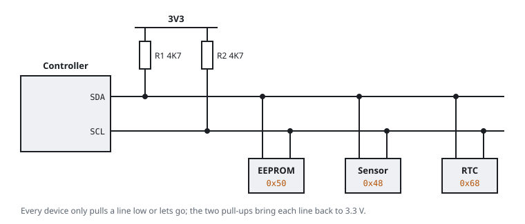

# I2C

I2C (Inter-Integrated Circuit, also written I²C or IIC) is a slow two-wire bus. It connects a controller to many small chips, such as EEPROMs with configuration data, temperature sensors, power management chips and LED drivers. SMBus, which PC mainboards use, is a close relative.

## Signals

| Signal | Purpose |
|---|---|
| SDA | data, in both directions |
| SCL | clock, driven by the controller |
| GND | shared reference |

## Open drain and pull-ups

A chip on an I2C bus never drives a line high. It can only pull the line to ground or let go. A pull-up resistor on each line brings the line high when no chip pulls it down. The resistor is typically 2.2 kΩ to 10 kΩ, connected to 3.3 V. In this way several chips can share a wire without a fight. It also explains what a meter shows: both lines idle at the supply voltage. The pull-up resistors are usually near the controller.

## Addresses

Each chip has a 7-bit address, written in hexadecimal. The part fixes some addresses. Address pins that you tie high or low set others. Common addresses:

| Address | Typical chip |
|---|---|
| 0x50 to 0x57 | 24Cxx EEPROM |
| 0x48 to 0x4F | temperature sensor |
| 0x68 | real-time clock |

## A transfer

1. Start: the controller pulls SDA low while SCL is high.
2. It sends the 7-bit address and one bit that says read or write.
3. The addressed chip acknowledges: it pulls SDA low for one clock.
4. The data bytes follow. The receiver acknowledges each byte.
5. Stop: SDA goes high while SCL is high.

Standard speed is 100 kHz and fast mode is 400 kHz. A logic analyzer at 2 MHz or more captures this well, and sigrok has an I2C decoder.

## I2C on a router

- An EEPROM on I2C can hold the MAC address, the serial number or calibration data.
- Some boards have SDA and SCL on test points next to the UART.
- In a Linux shell on the board, `i2cdetect` lists the addresses that answer, if it is installed.

Reading an I2C EEPROM is safe. If you write to it, you can erase the identity of the board. Treat it like flash and make a backup before you write.

Related: [SPI](spi), [Logic analyzer](logic-analyzer), [Reading schematics](reading-schematics).
