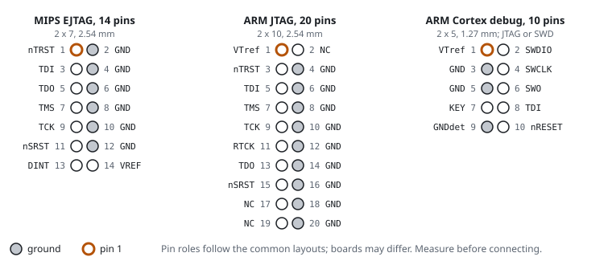

# JTAG and SWD

JTAG is a test and debug interface in most processors. A debug adapter can use it to stop the CPU and to read and write memory and registers. It can often program the flash. SWD (Serial Wire Debug) is the two-wire alternative from ARM, with the same purpose. Both give you much more control than a [UART](uart) console. They also give you more ways to break the board.

## JTAG signals

| Signal | Direction | Purpose |
|---|---|---|
| TCK | adapter to chip | clock |
| TMS | adapter to chip | mode select; steps the chip's JTAG state machine |
| TDI | adapter to chip | data in |
| TDO | chip to adapter | data out |
| TRST# | adapter to chip | optional JTAG reset |
| SRST#, nRESET | adapter to chip | optional system reset |
| VREF, VTref | chip to adapter | the target's I/O voltage, so the adapter matches it |
| GND | | several pins, for signal quality |

## Common headers

| Header | Pitch | Used on |
|---|---|---|
| 14-pin MIPS EJTAG (2 x 7) | 2.54 mm | MIPS routers: Lantiq, Broadcom, Atheros, MediaTek |
| 20-pin ARM JTAG (2 x 10) | 2.54 mm | older ARM boards |
| 10-pin ARM Cortex debug (2 x 5) | 1.27 mm | ARM boards; carries JTAG or SWD |

Router manufacturers often leave the header without pins, and sometimes they rearrange the pins. The ground pattern is the quickest check. On the 14-pin EJTAG layout, the even pins 2 to 12 are all ground.

## Identifying JTAG pins

1. With the power off, find the ground pins by continuity. A row of grounds on one side suggests EJTAG or ARM 20-pin.
2. With the power on, measure the other pins. VREF shows the I/O voltage and does not change. TDO is an output and sits at a defined level. The inputs (TCK, TMS and TDI) often have pull-ups or pull-downs.
3. If you do not know the layout, use a pin scanner. This is a JTAGulator, or open firmware on a Raspberry Pi Pico. The scanner tries every pin combination and reports the one that answers.

## SWD signals

| Signal | Shares the pin with | Purpose |
|---|---|---|
| SWDIO | TMS | data, both directions |
| SWCLK | TCK | clock |
| SWO | TDO | optional trace output |

SWD is common on ARM Cortex-M microcontrollers. You find these in Wi-Fi modules, smart home products and power supplies. Router SoCs usually use JTAG for debugging.

## Adapters and software

- OpenOCD is the open-source software that drives most adapters and knows most chips.
- Adapters are FT2232H-based boards, J-Link, ST-Link (ARM only), or a Raspberry Pi Pico with debug probe firmware.
- The adapter must match the VREF of the target. Most adapters read VREF and adjust. Cheap adapters have a fixed 3.3 V.

## Risks

- If you halt the CPU at the wrong moment, the peripherals can stay in a bad state until you power-cycle the board.
- A write to memory or flash through JTAG bypasses every protection of the bootloader. Use JTAG only to read until you have a verified backup.
- Many production SoCs disable JTAG with fuses or require authentication. A JTAG port that does not answer is common. It does not mean that the wiring is wrong.

Related: [Headers and pads](headers), [SoC](soc), [Reading datasheets](datasheets).
