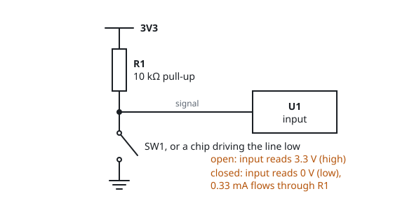
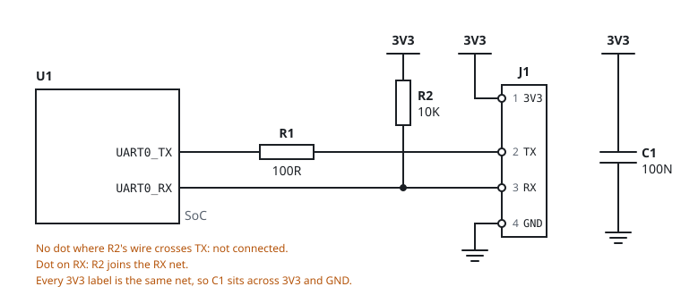

# Reading schematics

A schematic shows which component pins are electrically connected. It does not show where the parts
sit on the board or how long the copper tracks are. The board layout shows that. A schematic is a map of
connections, drawn for clarity.

Manufacturers rarely publish schematics for routers. You read schematics mostly in datasheets and in
reference designs. You also draw partial schematics yourself when you trace a header with a meter. The
header markers in this app are such a partial schematic.

## Nets

A net is a set of pins that are connected to each other. Every line in a schematic is part of a net,
and every point on one net is at the same voltage.

- Lines that cross **without** a dot are not connected.
- A dot where lines meet marks a junction. All of the lines are connected.
- A **net label** is a name, such as `UART0_TX`, written on a line. It connects every line with the same
  name, even on different pages. Large schematics use labels instead of long lines.
- **Power and ground symbols** are net labels too. Every ground symbol is the same net, and every
  `3V3` arrow is the same rail.

## Reference designators

Each component has a designator: a letter prefix and a number. The board prints the same designators
on its silkscreen. Use them to match a schematic to the hardware.

| Prefix | Component | Prefix | Component |
|---|---|---|---|
| R | resistor | U | integrated circuit (chip) |
| C | capacitor | J, CN, CON | connector or header |
| L | inductor | JP | jumper |
| FB | ferrite bead | Y, X | crystal or oscillator |
| D | diode, LED | SW | switch, button |
| Q | transistor | TP | test point |
| F | fuse | T | transformer (Ethernet magnetics) |

## Component values

A value has no decimal point. The unit prefix takes its place:

| Written | Means |
|---|---|
| `4K7` | 4.7 kΩ |
| `10K` | 10 kΩ |
| `0R` | 0 Ω: a link used as a configuration option |
| `100N` | 100 nF |
| `4U7` | 4.7 µF |
| `DNP`, `NC`, `NF` | do not populate: the footprint is on the board, the part is not fitted |

Production boards often have unfitted parts. Empty pads next to the UART can be the reason that a
console stays silent. A missing `0R` resistor on the TX line can be the reason too.

## Pins and pin 1

On a chip or connector symbol, each pin has a number and usually a name. The pin numbers match the
datasheet. On the board, one of these marks pin 1:

- a square pad among round ones,
- a dot, a notch or a bevelled corner on a chip,
- a small triangle, a `1` or a thicker outline on the silkscreen.

Every other pin number starts from pin 1. See [Headers and pads](headers) for the pin numbers on
2-row headers.

## Pull-up and pull-down resistors

A pull-up connects a signal to the supply through a resistor, usually 4.7 kΩ to 10 kΩ. When nothing
drives the signal, it stays at the supply voltage. When a chip drives the signal low, the small current
through the resistor is harmless (see [Electricity basics](electricity-basics)). A pull-down does the
same towards ground.

A receive line with a pull-up idles high, which is the correct idle state. An unconnected RX on the
board therefore does not produce noise. The pull-up also makes RX measure close to the rail voltage
when nothing is connected, so it is easy to confuse with VCC. TX moves during boot. RX and VCC do not.

## Series resistors

A series resistor of 22 Ω to 1 kΩ sits in a signal line, between the chip and the header. It limits
the current if someone connects a wire wrongly. It also reduces ringing on fast edges. On a router, the
resistors next to a UART or JTAG header are often series resistors. They do not affect a console at
normal speeds.

## Worked example: a UART header

Read the figure from left to right:

1. **U1** is the SoC. Its pins `UART0_TX` and `UART0_RX` are the serial port.
2. **R1** (100 Ω) sits in series with TX on the way to the header. It is a series resistor.
3. **R2** (10 kΩ) connects the RX line to 3V3. It is a pull-up, so RX idles high.
4. **J1** is the 4-pin header. Pin 1 is 3V3, pin 2 TX, pin 3 RX, pin 4 GND.
5. **C1** (100 nF) between 3V3 and GND is a decoupling capacitor.

This table shows what a meter reads on this header (see [UART](uart)):

| J1 pin | Unpowered, to GND | Powered |
|---|---|---|
| 1 (3V3) | a few hundred Ω to kΩ | steady 3.3 V |
| 2 (TX) | high, often `OL` | 3.3 V, dipping during boot output |
| 3 (RX) | pin 1's reading plus about 10 kΩ (R2) | steady close to 3.3 V |
| 4 (GND) | below 1 Ω, beeps | 0 V |

## Tracing a board without a schematic

1. Photograph the board and mark the header in the app. See [Photographing boards](photographing-boards).
2. With the board unplugged, find ground by continuity. See [Ground](ground).
3. Follow the tracks from each header pin with your eye and the photo. Note which resistor or chip pin
   each track reaches.
4. Confirm suspected connections with continuity from the header pin to the component pad.
5. Write what you find on the pins in the Header panel. That is your partial schematic.

Related: [Schematic symbols](schematic-symbols), [Headers and pads](headers), [UART](uart).
