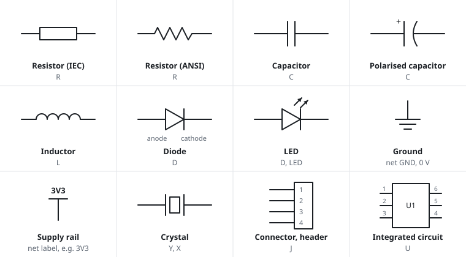

# Schematic symbols

The symbols below are the ones that router datasheets and reference designs use. Two drawing standards
exist. The IEC style is common in Europe, and a resistor is a rectangle. The ANSI style is common in
North America, and a resistor is a zigzag. Both appear in datasheets, so the figure shows both for the
resistor.

| Symbol | Designator | What it does | Where you see it on a router |
|---|---|---|---|
| Resistor | R | limits current, sets voltages | pull-ups, series resistors, dividers |
| Capacitor | C | stores charge, smooths supplies | next to every chip; large ones near the power input |
| Polarised capacitor | C | as above, with a marked + side | electrolytic cans near regulators |
| Inductor | L | resists changes in current | switching regulators |
| Diode | D | lets current flow one way only | reverse-polarity protection on the power input |
| LED | D, LED | a diode that emits light | front-panel status lights |
| Ground | | the 0 V reference net | everywhere |
| Supply | | a named supply rail, such as 3V3 | everywhere |
| Crystal | Y, X | sets a clock frequency | next to the SoC and Ethernet chips |
| Connector or header | J | where wires connect | UART, JTAG, power, USB |
| Chip | U | an integrated circuit, drawn as a box with numbered pins | SoC, RAM, flash, Ethernet switch |

## Reading direction and polarity

- A diode conducts from the **anode** to the **cathode**, in the direction of the triangle. The bar is
  the cathode. It matches the stripe printed on the part.
- On a polarised capacitor, the `+` marks the positive side. On the part itself, the stripe usually
  marks the negative side.
- By convention, ground symbols point down and supply arrows point up. Voltage is therefore high at the
  top of a schematic and low at the bottom.

## Chip symbols

A chip is a rectangle with its pins around the edge. The drawing arranges the pins by function: power
on top, ground at the bottom, inputs on the left, outputs on the right. The physical package does not
follow this order. The pin numbers match the pinout diagram in the datasheet.

A bar over a name means that the signal is active low. A `#` or `_N` suffix, or an `n` prefix
(`nRESET`, `RESET#`), means the same. An active-low signal does its job when something pulls it to 0 V.

Related: [Reading schematics](reading-schematics), [Electricity basics](electricity-basics).
