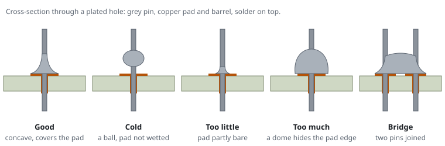

# Soldering

Soldering joins a component lead to a copper pad with molten metal (solder). For console work you need it for one job: to fit a pin header into a row of holes. Sometimes you also need it to clear holes that the factory filled with solder. Learn it on a practice board before you work on a board you care about.

## What you need

| Item | Recommended | Why |
|---|---|---|
| Iron | temperature controlled, 40 W or more | steady heat on ground pins |
| Tip | chisel, 1.6 mm to 2.4 mm | transfers heat to a pin and pad much better than a fine conical tip |
| Solder | 0.6 mm to 0.8 mm, rosin flux core, Sn60Pb40 or Sn63Pb37 | leaded solder melts at a lower temperature and flows more easily than lead-free |
| Flux | no-clean flux pen or paste | lets solder flow and makes clearing holes reliable |
| Desoldering wick | 2 mm wide | removes solder from holes and bridges |
| Tip cleaner | brass wool in a holder | cleans without cooling the tip |
| Stand | the one supplied with the iron | the iron is always in it when it is not in your hand |
| Board holder | helping hands or a PCB vice | both hands stay free for iron and solder |
| Safety glasses | any | flux spits and clipped leads fly |
| Practice board | a through-hole practice kit, or perfboard with header strips | your first joints |

A fine conical tip works for headers, but it needs a longer contact time. A plain 25 W to 30 W pencil iron has no temperature control. It can fit a header on signal pins. Ground pins that connect to large copper areas may not get hot enough.

## Temperature

| Solder | Iron setting |
|---|---|
| Leaded (Sn60Pb40, Sn63Pb37) | 320 °C to 350 °C |
| Lead-free (SAC305) | 350 °C to 380 °C |

Factory joints on routers are lead-free. If you add a little leaded solder to them, their melting point drops and they are easier to rework.

## Health and safety

- The tip is at over 300 °C. Always return the iron to its stand. Never put it down on the desk.
- The smoke is flux fumes, which irritate the airways. Work in a ventilated room, or use a small fan to draw the smoke away from your face.
- Leaded solder is a health risk. Do not eat or drink at the bench, and wash your hands after you solder.
- Unplug the board before you solder it. See [Bench safety](safety).

## Preparing the tip

1. Heat the iron to the set temperature.
2. Wipe the tip in the brass wool.
3. Melt a little solder onto the tip, so the tip is coated and shiny. This is tinning.
4. Tin the tip again before you put the iron back in its stand and before you switch it off.

A tip that stays dull or black and does not take solder transfers heat badly. Clean it and tin it again.

## Making a through-hole joint

1. Place the tip so that it touches both the pin and the pad at the same time.
2. Hold it there for one to two seconds.
3. Feed solder into the joint on the side opposite the tip, where the pin meets the pad. The solder melts on the joint and flows around the pin.
4. Remove the solder, then the iron. The whole joint takes about three seconds.
5. Do not move the part until the solder has set. This takes a second.

| Joint | Looks like | Cause | Fix |
|---|---|---|---|
| Good | a smooth concave cone around the pin, covering the pad | | |
| Cold | dull, grainy, or a ball sitting on the pin | not enough heat, or the part moved while the solder set | add flux, reheat |
| Too little | the pad or hole is not covered | not enough solder | add solder |
| Too much | a round blob that hides the pad edge | too much solder | remove some with wick |
| Bridge | solder joining two neighbouring pins | too much solder, or the tip dragged across | flux and wick, or drag the clean tip away |

## Fitting a pin header

1. Use a straight male pin header with 2.54 mm pitch. Break a strip to length: 1 x 4 for a typical UART, 2 x 7 for a 14-pin JTAG header.
2. Insert it from the component side of the board, with the long pins up.
3. Turn the board over in the holder. Solder **one** pin only.
4. Check that the header sits flat and square. If it does not, reheat that one pin. Press the header straight with a finger on the plastic, not on the pin.
5. Solder the pin at the opposite end, then the rest.
6. Inspect each joint. Then check with the meter that no two neighbouring pins beep against each other.

Ground pins connect to large copper areas that draw heat away. They need a longer contact time or a higher temperature. A cold joint is most likely on a ground pin.

## Clearing a filled hole

The factory often fills the holes for an unfitted header with solder.

1. Add flux to the hole.
2. Lay desoldering wick over the hole and press the hot tip on top of the wick.
3. When the solder melts, the wick draws it in. Lift the wick and the iron together.
4. Cut off the used part of the wick. Repeat until the hole is clear, or clear it from both sides.

Lift the wick while it is still hot. Wick that cools in place solders itself to the pad, and if you pull it you can tear the pad off the board.

## Practice plan

1. Tin the tip and make twenty joints on a practice board or perfboard. Continue until each joint looks like the good joint in the figure.
2. Fit a 1 x 4 and a 2 x 7 header strip to perfboard.
3. Remove one strip with wick, clear the holes, and fit the strip again.
4. Only then work on the real board.

Related: [Headers and pads](headers), [Wiring](wiring), [Bench safety](safety).
