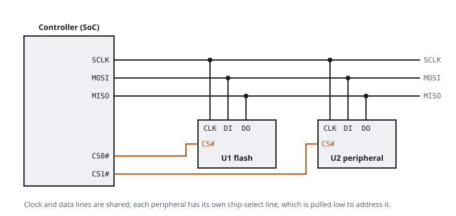

# SPI

SPI (Serial Peripheral Interface) is a fast bus for short distances between one controller and one or more peripherals. On a router, the main use is the connection between the SoC and the SPI flash that holds the firmware.

## Signals

| Signal | Also called | Direction | Purpose |
|---|---|---|---|
| SCLK | CLK, SCK | controller to peripheral | the clock; one bit moves per clock cycle |
| MOSI | DI, SDI, COPI, IO0 | controller to peripheral | data into the peripheral |
| MISO | DO, SDO, CIPO, IO1 | peripheral to controller | data out of the peripheral |
| CS# | SS, CE#, nCS | controller to peripheral | selects one peripheral; active low |

All peripherals share SCLK, MOSI and MISO. Each peripheral has its own CS# line. Only the selected peripheral answers.

## How a transfer works

1. The controller pulls CS# low.
2. It sends a command byte on MOSI, one bit for each clock pulse. For a flash chip, `0x03` means "read" and `0x9F` means "send your ID".
3. It sends the address bytes, if the command needs them. Then it keeps the clock running while the peripheral returns data on MISO.
4. It releases CS#, which ends the transfer.

Clock speeds range from a few MHz to over 100 MHz. The SPI mode (0 to 3) sets the clock edge on which the data is read. Flash chips use mode 0 or mode 3.

## Quad SPI

Most current flash chips also support dual and quad transfers. In these modes WP# and HOLD# become extra data lines (IO2 and IO3), and the chip moves four bits for each clock. A reader such as flashrom uses plain single-bit SPI, which every chip supports.

## SPI flash pinout

The 8-pin flash chips on routers share one pinout. This is the view from above, with pin 1 at the dot:

| Pin | Signal | Pin | Signal |
|---|---|---|---|
| 1 | CS# | 8 | VCC |
| 2 | DO (MISO) | 7 | HOLD# or RESET# |
| 3 | WP# | 6 | CLK |
| 4 | GND | 5 | DI (MOSI) |

## Reading a flash chip in circuit

A programmer (a CH341A, or a Raspberry Pi with flashrom) connects to the chip through a SOIC-8 clip. In the circuit, the programmer must power the chip through its VCC pin. This also powers part of the board. Two problems follow:

- The SoC may wake up and drive the same bus. Then the read fails or returns different data each time. To detect this, hold the SoC in reset, or read twice and compare the hashes.
- The programmer must supply 3.3 V on VCC and on its data lines. Some CH341A boards drive their data pins at 5 V, even when you set them to 3.3 V. Check yours with a meter before you connect it to a chip.

Planned flash playbooks will cover this procedure: two reads, a hash comparison and a read-only copy of the dump.

Related: [SPI flash](spi-flash), [Flash and filesystems](flash-and-filesystems), [Logic analyzer](logic-analyzer).
