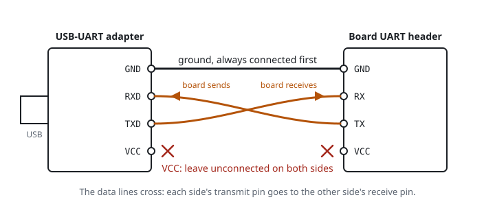

# USB-UART adapter

A USB-UART adapter (also sold as a USB-TTL or USB-serial adapter) converts between USB on the laptop and the [UART](uart) signals on a board. The common chips are the Silicon Labs CP2102, the FTDI FT232R and the WCH CH340. All three work with Linux out of the box.

## Pins

| Adapter pin | Connect to | Notes |
|---|---|---|
| GND | board GND | always first |
| RXD | board TX | the adapter receives what the board sends |
| TXD | board RX | the adapter sends what you type |
| VCC, 3V3, 5V | nothing | the board has its own supply |
| DTR, RTS, CTS | nothing | modem control lines, not used for a console |



## Signal level and the jumper

The adapter's TXD idles at its signal level. Check the level before you connect the adapter to a board. Plug the adapter into the laptop, then measure TXD against the adapter's own GND.

| Chip | Signal level | What the 3V3 / 5V jumper does on typical modules |
|---|---|---|
| CP2102 | 3.3 V, fixed; inputs tolerate 5 V | selects the voltage on the VCC pin only |
| FT232R | set by its VCCIO pin | selects the signal level |
| CH340 | follows its supply, 3.3 V or 5 V | selects the signal level on most modules |

A 3.3 V adapter suits nearly all routers. A 1.8 V board needs an adapter that supports 1.8 V, or a level shifter between the adapter and the board. See [Logic levels](logic-levels).

## On Linux

The kernel drivers are `cp210x`, `ftdi_sio` and `ch341`. When you plug in the adapter, the kernel log names it:

```
journalctl -k -n 20
```

The port appears as `/dev/ttyUSB0`. The number increases with more adapters. Two stable names point at the same port:

- `/dev/serial/by-id/usb-Silicon_Labs_CP2102_...` uses the adapter's serial number. Many cheap CP2102 modules share the serial number `0001`, so two of them get the same name.
- `/dev/serial/by-path/...` uses the USB port. Use this name when adapters share a serial number.

### Permission to open the port

On Arch Linux, serial ports belong to the group `uucp`. Add yourself to the group once, then log out and back in:

```
sudo usermod -aG uucp $USER
```

The command `groups` lists your groups. Without `uucp`, opening the port fails with "Permission denied".

## Talking to the board

The Console panel opens the port, detects the speed and saves the session as a capture. Outside the app, a small terminal program does the same job. `tio` is in the AUR. `picocom` is in the official repositories:

```
yay -S tio
tio -b 115200 /dev/ttyUSB0
```

```
sudo pacman -S picocom
picocom -b 115200 /dev/ttyUSB0
```

Quit tio with `Ctrl-t q` and picocom with `Ctrl-a Ctrl-x`. Only one program can hold the port at a time.

## Checking the adapter on its own

A loopback test shows that the adapter works before you connect a board:

1. Connect the adapter's TXD to its own RXD with one jumper wire.
2. Open the port at any speed.
3. Type. Every character appears, because it travels out of TXD and straight back into RXD.
4. Remove the wire. Now typing shows nothing.

Related: [Wiring](wiring), [UART](uart), [Logic levels](logic-levels).
